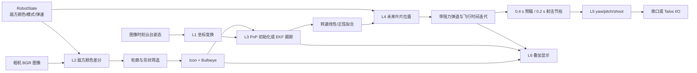

# Buff 算法代码学习手册

> 本文按当前工作区代码整理，目标是回答三件事：Buff 代码在哪里、每一帧怎样从图像走到控制命令、学习和调试时应该先看什么。
>
> 更新：运行时已接入 `model/buff_model/buff.onnx`。当前默认采用网络找靶面和判状态、传统方法提取中心 R 与 PnP 十字端点；`detector.method: traditional` 可恢复本手册下述传统检测路径。模型配置和几何适配说明见 [buff.md](buff.md)。下文跟踪、规划说明仍适用。

## 1. 先记住这 8 个结论

1. Buff 是一条与装甲板自瞄分离的 L1～L6 链路：
   `图像/姿态 → 传统视觉检测 → PnP 初始化 → 像素域 EKF → 转速拟合 → 命中时刻预测 → 弹道 → 开火节拍 → 安全控制`。
2. 当前 `SmallBuff` 和 `BigBuff` 只负责把运行时路由到 Buff；两种模式进入的是同一个 `runtime::buff::Runtime`，没有独立参数，也没有把模式传给估计器。匀速或正弦变速由数据拟合结果决定。
3. L2 检测输出两类二维特征：中心图标 `Icon` 和靶面 `Bullseye`。`Bullseye::corners` 是十字四臂端点，不是矩形四角。
4. `Bullseye::active` 的名字很容易读反：代码用 `!active` 表示“未激活、可选作目标的叶片”。初始化、续命和规划都依赖这种 `!active` 观测。
5. L3 的核心状态是
   \[
   \mathbf{x}=[x,y,z,\omega,\alpha,\psi]^T
   \]
   即符中心三维位置、旋转角速度、0 号叶片相位、符面朝向 yaw。
6. EKF 在像素平面更新：预测 1 个中心图标和 5 个叶片中心，用匈牙利算法将它们与本帧观测关联，再逐点做 EKF 修正。
7. L4 不只做简单的 `距离 / 弹速`。它迭代“目标未来位置 ↔ 带重力和阻力的飞行时间”，最多 5 次，然后叠加 `shoot_delay` 与本帧算法延迟。
8. 当前默认不会实弹开火：`config/buff.yaml` 的 `control.shoot_enable` 为 `false`；Talos 还有第二层 `config/talos.yaml: talos.shoot_enable` 闸门。

> **当前硬件配置提醒：** `config/auto_aim.yaml` 的 `debug.force_work_mode`
> 目前为 `small_buff`，硬件运行时强制走 Buff 分支；清空后跟随下位机模式。
> `debug.force_enemy_color` 可设为 `red`/`blue`，空串跟随下位机目标颜色。
> Talos 后端清除这两个覆盖，使用 `config/talos.yaml` 的配置。

## 2. 一帧数据怎样流动



实机主循环位于 `src/runtime/auto_aim_runtime.cpp`。Buff 分支的实际顺序是：

1. 根据下位机 `WorkMode` 进入 `SmallBuff` 或 `BigBuff` 分支。
2. `buff_runtime->detect(frame, enemy_color)` 先做检测。
3. 等待并查询图像曝光时刻的云台姿态 `gimbalPoseAt(timestamp)`。
4. `L1Sensor::Buff::composeCameraPose()` 合成 `world <- camera_ros` 位姿。
5. `buff_runtime->update()` 执行 L3～L5。
6. 每帧最多发布一条命令；从装甲板模式切入时，如果 Buff 首帧还没有有效计划，就保持旧角度并关火。

检测先于等待姿态，是为了把检测耗时利用起来；姿态仍使用图像时刻而不是规划时刻。
硬件状态中的模式值由串口协议映射：`2 -> SmallBuff`、`3 -> BigBuff`；但分派前还会先应用
`debug.force_work_mode`。因此判断“下位机已经发了小符模式但代码为什么没进 Buff”时，第一步应检查这个覆盖项。

## 3. 文件地图：哪些正在工作，哪些只是预留

### 3.1 主链路

| 层 | 文件 | 作用 | 当前状态 |
|---|---|---|---|
| 配置 | `config/buff.yaml` | 检测、跟踪、规划、控制参数 | 生效 |
| 配置 | `config/auto_aim.yaml` | `force_work_mode`/`force_enemy_color` 覆盖模式/目标颜色 | 生效 |
| 配置 | `config/talos.yaml` | Talos 敌方颜色、模式、弹速及第二层开火许可 | Talos 生效 |
| L1 | `include/l1_sensor/buff/transform.hpp`、`src/l1_sensor/buff/transform.cpp` | 合成相机世界位姿，避免光学轴换轴做两次 | 生效 |
| L1 | `include/l1_sensor/serial/robot_state.hpp` | `EnemyColor`、`SmallBuff/BigBuff`、实时弹速 | 生效 |
| L1 | `src/l1_sensor/serial/serial_protocol.cpp` | 串口模式值：2→小符，3→大符 | 生效 |
| L2 | `include/l2_perception/buff/types.hpp` | `Icon`、`Bullseye`、`Detections` | 生效 |
| L2 | `src/l2_perception/buff/buff_detector.cpp` | 颜色差分、轮廓、骨架、四臂极坐标特征 | 生效，核心入口 |
| L3 | `src/l3_estimation/buff/pnp_solver.cpp` | 5 点 PnP，恢复符中心与符面姿态 | 生效 |
| L3 | `include/l3_estimation/buff/types.hpp` | 几何常量、状态、配置、调试关联点 | 生效 |
| L3 | `src/l3_estimation/buff/target_estimator.cpp` | 初始化、投影、Jacobian、匈牙利关联、EKF、模型选择 | 生效，算法核心 |
| L3 | `src/l3_estimation/buff/energy_fitter.cpp` | 6 秒窗口内拟合匀速或正弦角速度 | 生效 |
| L3 | `src/l3_estimation/buff/tracker.cpp` | 模型生命周期、预测/修正、1.5 秒超时 | 生效 |
| L4 | `src/l4_planning/buff/trajectory_solver.cpp` | 重力、二次阻力、数值积分弹道 | 生效 |
| L4 | `src/l4_planning/buff/planner.cpp` | 选叶、未来位置、飞行时间迭代、瞄准角 | 生效 |
| L4 | `src/l4_planning/buff/attack_scheduler.cpp` | 0.4 秒 idle / 0.2 秒 shoot 周期 | 生效 |
| L5 | `src/l5_control/buff/controller.cpp` | 生成绝对世界 yaw/pitch 和 shoot；失败时安全保持 | 生效 |
| Runtime | `src/runtime/buff/buff_runtime.cpp` | 串接 L2～L5，执行 100 ms 旧目标保护 | 生效 |
| Runtime | `src/runtime/buff/buff_config.cpp` | YAML 读取、兼容旧字段、部分关键坏值回退 | 生效 |
| Runtime | `src/runtime/auto_aim_runtime.cpp` | 模式路由、姿态对时、命令发布与模式切换 | 生效 |
| L6 | `src/l6_telemetry/buff/overlay.cpp` | 检测、关联、规划状态叠加 | 生效，需开关或回放工具 |
| 工具 | `tools/replay/buff_video_replay.cpp` | 不开相机/串口的 L2～L5 视频回放 | 生效，首选学习工具 |

### 3.2 模型接入与其他预留内容

| 文件/字段 | 现状 |
|---|---|
| `model/buff_model/buff.onnx/.xml/.bin` | 默认启用 ONNX，模型路径由 buff.yaml 指定 |
| `include/l2_perception/buff/buff_decoder.hpp` | 模型解码接口 |
| `src/l2_perception/buff/buff_decoder.cpp` | 四类/四点解码、颜色筛选、NMS 和原图坐标还原 |
| `Config::plot` / `debug.plot` | YAML 能读取，但 Buff 运行时没有发送或落盘逻辑 |
| `L6Telemetry::Buff::csvHeader()/toCsv()` | CSV 序列化函数存在，但主循环没有调用 |
| `State::aimpoints()` | 已实现，但当前 Planner 自己计算攻击点，没有调用它 |
| `TargetEstimator::converge()` | 恒返回 `true`，当前也没有调用；真正预热门限在 Planner 内 |

模型 XML 自带的元数据为：YOLOv8n pose、输入 `1×3×640×640`、4 个类别
`BR/BW/RR/RW`、每个目标 4 个二维关键点、输出 `1×16×8400`。B/R 前缀表示蓝/红，R/W 后缀对应待打/已激活；待打靶的关键点不是现有 PnP 的十字外端点，需要 ROI 几何精修。模型元数据声明 AGPL-3.0。

## 4. 坐标系与角度约定

这是最值得先弄清的部分。符能被检测到但云台方向完全错误，通常不是 EKF，而是坐标链错了。

### 4.1 四个主要坐标系

| 坐标系 | 轴约定 |
|---|---|
| OpenCV optical | `x` 右、`y` 下、`z` 前 |
| `camera_ros` | `x` 前、`y` 左、`z` 上 |
| barrel | `x` 枪口方向、`y` 左、`z` 上 |
| world | 下位机 IMU 绝对世界系 |

`T_A_B` 表示把 B 系点变换到 A 系。相机标定里的 `T_barrel_camera` 是
`camera optical -> barrel`，不是 `camera_ros -> barrel`。

PnP 内部先按 OpenCV 规则求解，再把结果转成 `camera_ros`。因此 L1 组合姿态时必须使用：

\[
R_{world\leftarrow camera\_ros}
=R_{world\leftarrow barrel}
R_{barrel\leftarrow optical}
R_{optical\leftarrow camera\_ros}
\]

`composeCameraPose()` 正是在做这个组合。纯轴向安装时，后两个旋转应互相抵消；
`buff_math_smoke` 专门检查了这一点，防止把光学轴转换重复施加一次。

相机平移使用：

\[
t_{world\leftarrow camera}=R_{world\leftarrow barrel}\,t_{barrel\leftarrow camera}
\]

当前代码没有额外的世界原点平移，默认 barrel/IMU 的平移基准就是世界位置基准。

### 4.2 pitch 符号

项目内部 `pitch` 为右手绕 Y：

- 正值：低头；
- 负值：抬头。

弹道求解内部使用常见的“向上为正”的发射仰角，返回时取负号转换成项目 pitch。
Talos 线协议还会编码成 `-project_pitch - 90°`；那是 I/O 协议适配，不是 Buff 算法坐标变换。

### 4.3 两类时间

- `image_timestamp`：图像对应的曝光时刻，用于查询姿态和更新滤波器。
- `plan_time`：L2/L3 运行之后准备规划的当前时刻。

Planner 会把 `plan_time - state.timestamp` 加入目标外推时间，以补偿本帧图像到规划的处理延迟。

## 5. L2：传统颜色和形状检测

入口是 `L2Perception::Buff::Detector::detect()`。

### 5.1 敌方颜色掩膜

输入必须是 `CV_8UC3` BGR 图像，并且敌方颜色不能是 `Unknown`。以红方目标为例：

```text
R - B > 40
R - G > 20
R     > 80
```

蓝方则交换 R/B。三个二值条件取与，最后做一次 `3×3` 椭圆核膨胀。

这意味着以下情况会直接导致空检测：

- 下位机没有给出敌方颜色；
- 通道顺序不是 BGR；
- 曝光过低，目标主通道低于 80；
- 白色高亮区域因颜色纯度不足被滤掉。

### 5.2 尺度不是写死的像素值

轮廓允许尺度由内参、物理尺寸、距离范围和最大透视角共同计算。默认：

- 距离 `1.7～5.0 m`；
- 最大透视角 `60°`；
- 靶面特征半径 `0.15 m`；
- 图标特征半径 `0.05 m`；
- 上下界另放宽 10%。

以物理半径 \(r\)、平均焦距 \(f=(f_x+f_y)/2\)、透视上限 \(\theta\) 为例，像素半径近似范围是：

\[
r_{px,min}=\frac{fr\cos\theta}{d_{max}}(1-0.1),\qquad
r_{px,max}=\frac{fr}{d_{min}\cos\theta}(1+0.1)
\]

因此更换分辨率或 ROI 后不能只沿用旧内参；尺度门限会整体错误。

### 5.3 靶面候选

外轮廓至少需要 5 个点以拟合椭圆，并依次检查：

1. 等效半径是否落在靶面范围；
2. 椭圆短长轴比是否不小于 `cos(max_perspective)`；
3. `contour_area / ellipse_area` 是否在 `[0.7, 1.3]`；
4. 圆度是否通过透视相关阈值；
5. 中心非常接近的重复轮廓分组后只保留最大者。

落在任何靶面轮廓内部的图标候选会被删除，避免同一发光结构被重复解释。

### 5.4 中心图标 `Icon` 打分

图标 ROI 的处理是：

1. 灰度化并用 Otsu 二值化；
2. Zhang-Suen 细化得到单像素骨架；
3. 骨架必须只有 1 个连通分量；
4. 统计端点、下半区端点和分叉点；
5. 统计轮廓孔洞。

通过条件为：

```text
端点 >= 1
下半区端点 >= 1
8 <= 分叉点 <= 50
孔洞 <= 2
```

得分是 `0.5 + 0.1 * 端点数`。默认 `match_threshold=0.5`，所以刚好 0.5 也会通过。

### 5.5 靶面四臂特征与 `active` 陷阱

靶面 ROI 被转换为 `32` 个径向 bin、`180` 个角向 bin 的极坐标能量图。角向能量额外乘以半径权重，使外侧臂端更显著。随后利用四重谐波估计十字相位，并比较四个峰与四个谷：

\[
pvd=\frac{\overline{peak}-\overline{valley}}
{\overline{peak}+\overline{valley}+10^{-10}}
\]

当前字段语义必须按代码记：

| 条件 | `Bullseye::active` | L3 的解释 | overlay 颜色 |
|---|---:|---|---|
| `pvd < active_threshold` | `true` | 已激活，不作为待打叶片 | 绿 |
| `pvd >= active_threshold` | `false` | `!active`，未激活/待打 | 红 |

低 PVD 分支按径向峰值给出上下左右端点；高 PVD 分支沿估计出的四个臂方向寻找 25% 能量边界，并要求四臂长度标准差不超过均值的 30%。

阅读代码时不要把 `active=true` 理解成“当前要攻击”。当前要攻击的是 `!active`。

## 6. L3 初始化：5 点 PnP 如何建立三维符模型

### 6.1 几何常量

`include/l3_estimation/buff/types.hpp` 定义了符面局部几何：

| 点 | 局部坐标，单位 m |
|---|---|
| 中心图标 | `(-0.1, 0, 0)` |
| 靶面上端 | `(0, 0, 0.7 + 0.15)` |
| 靶面左端 | `(0, +0.15, 0.7)` |
| 靶面下端 | `(0, 0, 0.7 - 0.15)` |
| 靶面右端 | `(0, -0.15, 0.7)` |

所以全局叶片半径为 `0.7 m`，靶面半尺寸为 `0.15 m`，中心图标相对符面沿 x 偏置 `0.1 m`。

### 6.2 二维端点排序

检测器输出的 4 个端点没有 T/L/B/R 身份。PnP 以图标中心为参照：

1. 距离图标最近的端点是 Bottom；
2. 最远的是 Top；
3. 用 Top-Bottom 建立图像内局部 z 轴；
4. 剩余两点投影到其正交轴，区分 Left/Right。

最终使用 `[Icon, Top, Left, Bottom, Right]` 对应 5 个三维点。

### 6.3 两阶段 PnP

先运行 `SOLVEPNP_EPNP` 得到初值，再以该结果运行 `SOLVEPNP_ITERATIVE` 精修；两步都要求 OpenCV 光学系中的深度 `z > 0`。结果随后从 OpenCV optical 转回 `camera_ros`。

### 6.4 初始化不是“第一个 PnP 成功就用”

`TargetEstimator::init()` 要求：

- 至少 1 个 `Icon`；
- `!active` 靶面数量必须是 1 或 2；多于 2 个也拒绝初始化；
- 枚举每个图标和每个未激活靶面的组合。

每个候选还要通过：

1. 5 个真实特征点的重投影 RMS 不超过 `10 px`；
2. 单点最大误差不超过 `20 px`；
3. 符面法向的 pitch 不超过 `20°`；
4. 符面方向必须朝相机可接受的一侧；
5. 种子叶片中心误差不超过 `30 px`；
6. 如果还有第二个未激活观测，检查它能否与其余 4 个叶片之一对应。

候选按“第二叶片内点数、种子中心误差、图标误差、最大重投影误差、总误差”依次择优。

## 7. L3 跟踪：6 维 EKF 与 6 个像素特征

### 7.1 状态含义

| 下标 | 变量 | 含义 |
|---:|---|---|
| 0 | `x` | 符中心世界 x |
| 1 | `y` | 符中心世界 y |
| 2 | `z` | 符中心世界 z |
| 3 | `rotation_speed` / `w` | 角速度，rad/s |
| 4 | `rotation_angle` / `alpha` | 0 号叶片相位，连续角，不做 `[-π,π]` 归一化 |
| 5 | `face_yaw` / `psi` | 符面绕世界 z 的朝向 |

初始协方差对角线为：

```text
[64, 64, 64, 100, 25, 10]
```

### 7.2 运动模型

普通预测只做：

\[
\alpha_{k+1}=\alpha_k+\omega_k\Delta t
\]

其余状态保持常量，因此状态转移矩阵只有 `F(alpha,w)=dt` 这一项非零。过程噪声直接逐帧加到协方差，没有按 `dt` 缩放；调整帧率后，同样的 YAML 噪声会对应不同的每秒扩散量，调参时要注意这一点。

转速拟合结果不会回写 EKF 的 `posterior[w]`。EKF 仍用自己的 `w` 做下一帧先验；拟合速度只放进输出 `State`，供 L4 远期预测使用。

### 7.3 观测模型

预测的 6 个特征是：

- feature 0：中心图标 `(-0.1,0,0)`；
- feature 1～5：相差 `72°` 的 5 个叶片中心。

第 \(i\) 个叶片中心在符面局部系中为：

\[
p_i=
\begin{bmatrix}
0\\
-R\sin(\alpha+i\cdot72^\circ)\\
R\cos(\alpha+i\cdot72^\circ)
\end{bmatrix},\quad R=0.7
\]

再依次经过 `face_yaw`、符中心平移、`world -> camera_ros -> optical` 和相机投影得到像素点。

投影本身调用 `cv::projectPoints()`，因此会使用畸变参数；手写 Jacobian 使用针孔模型的 `fx/fy`，没有包含畸变导数。这是当前实现的近似，画面边缘或大畸变镜头下要重点观察新息。

### 7.4 匈牙利关联与卡方门限

观测先做类型约束：

- `Icon` 只能匹配 feature 0；
- `Bullseye` 只能匹配 feature 1～5。

每个可行组合的代价是马氏距离：

\[
d^2=(z-h(x))^T(HPH^T+R)^{-1}(z-h(x))
\]

用匈牙利算法做一对一分配，并允许观测匹配到代价为 `gate_threshold` 的 dummy 列。默认 `13.816` 接近二维卡方分布 99.9% 门限。

`noise_observation=20` 是观测协方差矩阵的对角元素，即像素方差约为 `20 px²`，对应标准差约 `4.47 px`，不是 20 px 标准差。

关联后逐个观测做 EKF 更新，协方差采用 Joseph 形式：

\[
P=(I-KH)P(I-KH)^T+KRK^T
\]

然后强制对称化，减少数值误差。

### 7.5 “看到目标”不等于“给模型续命”

所有成功关联的靶面都会修正 EKF，但只有 `!active` 靶面会：

- 把对应叶片标成 `inactive=true`；
- 将该标记保持 `inactive_timeout_ms=100 ms`；
- 令 `TargetEstimator::correct()` 返回 `true`；
- 更新 Tracker 的 `corrected_stamp_`。

因此：

- 只有图标或只有 `active=true` 靶面时，状态可以被更新，但 1.5 秒模型生命周期不会续期；
- 规划只攻击最近 100 ms 内明确观测为 `!active` 的叶片；
- 连续 1.5 秒没有成功修正未激活叶片，Tracker 会销毁模型并等待重新 PnP 初始化。

这三个时间不要混淆：

| 门限 | 作用 |
|---|---|
| 100 ms `inactive_timeout` | 叶片“未激活”身份有效期 |
| 100 ms Runtime stale guard | 整个跟踪状态可用于继续发命令的最大观测年龄 |
| 1.5 s `timeout_seconds` | 估计模型的最终销毁时间 |

### 7.6 发散判定

满足任一条件就重置模型：

- `Pxx` 或 `Pyy > 150`；
- `|x|` 或 `|y| > 15 m`；
- `|z| > 5 m`；
- `|w| > 10π rad/s`；
- 符面朝向与中心方位夹角超过默认 `45°`；
- 任意状态非有限值。

## 8. 大符/小符的速度模型

当前代码没有用 `WorkMode` 强行指定“大符用正弦、小符用匀速”，而是同时拟合两个模型并按代价选择。

### 8.1 数据窗口

- 初始化后满 1 秒才开始向拟合器送样本；
- 拟合器至少需要 `1.5 s` 的样本跨度；
- 最多保留最近 `6 s`；
- 权重半衰期 `3 s`，样本权重为

\[
w_i=2^{(t_i-t_{latest})/3}
\]

所以理想连续观测下，首次真正可拟合通常约在初始化后 `2.5 s`，不是 1.5 s。

### 8.2 线性模型

对连续相位做加权直线拟合：

\[
\theta(t)=C+vt
\]

`v` 作为 Planner 使用的匀速预测角速度。

### 8.3 正弦变速模型

先在 `1.80～2.20 rad/s` 内扫描正弦频率。每个候选频率都通过加权线性最小二乘求：

\[
\theta(t)=C+vt+A\cos(\Omega t)+B\sin(\Omega t)
\]

再转换成代码使用的形式：

\[
\theta(t)=C+vt-\frac{a}{\Omega}\cos(\Omega t+\phi)
\]

其瞬时角速度为：

\[
\dot\theta(t)=v+a\sin(\Omega t+\phi)
\]

其中：

\[
a=\Omega\sqrt{A^2+B^2},\qquad
\phi=\operatorname{atan2}(B,-A)
\]

### 8.4 模型选择

优先选择正弦模型的条件是：

```text
正弦拟合存在，并且满足以下任一项：
1. 线性拟合不存在；
2. 当前处于 force_sine 窗口；
3. 正弦 cost < 线性 cost 且正弦速度幅值 a >= 0.6 rad/s。
```

同一帧关联到超过 1 个未激活叶片时，会强制正弦模型 3 秒。否则不满足上述条件就使用线性模型。

Planner 的预热时间按最终模型决定：

- 线性/尚无正弦模型：初始化后 3 秒；
- 正弦模型：初始化后 6 秒。

预热期仍会瞄准符中心，但 `degraded=true`，禁止算法开火。

## 9. L4：选叶、未来位置和弹道

### 9.1 弹速策略

每帧优先使用下位机上报的实时弹速：

```text
finite && speed >= min_valid_bullet_speed
```

默认最小有效弹速为 `14 m/s`。无效时使用 `22.5 m/s` 回退值继续计算跟随角，但回退值默认 `trusted=false`，所以不能进入开火节拍。只有显式配置 `trust_fallback_bullet_speed=true` 才允许按回退值开火。

### 9.2 未来叶片位置

Planner 总是选择 `inactive[0..4]` 中索引最小的第一个叶片。叶片未来相位由 `State::transition()` 计算：

- 正弦模型有效：解析积分瞬时角速度；
- 否则：`alpha += rotation_speed * dt`。

未来攻击点为：

\[
p_{attack}=p_{center}+
R_z(\psi)
\begin{bmatrix}
0\\-0.7\sin\alpha\\0.7\cos\alpha
\end{bmatrix}
\]

用于 overlay 的 `attack_box` 是以该点为中心、半尺寸 `0.15 m` 的符面内正方形，只供重投影显示，不参与选叶、弹道或开火判定。

### 9.3 飞行时间与目标预测互相依赖

第一次用 `center.norm() / bullet_speed` 估计飞行时间。之后最多迭代 5 次：

```text
prediction = fly_time + shoot_delay + image_to_plan_age
未来状态 = 当前状态.transition(prediction)
attack = 未来未激活叶片中心
new_fly_time = trajectory.solve(attack)
```

相邻两次飞行时间差小于 `1 ms` 时停止。

### 9.4 数值弹道

`TrajectorySolver` 将三维点拆成水平距离和高度，用 `5 ms` 步长积分：

\[
\dot v_x=-k|v|v_x,\qquad
\dot v_z=-g-k|v|v_z
\]

默认：

- `g = 9.81 m/s²`；
- 二次阻力系数 `k = 0.003`；
- 积分步长 `5 ms`；
- 单次轨迹最长 `4 s`；
- 最多修正发射 pitch 10 次；
- 高度误差收敛阈值 `1 mm`；
- pitch 绝对值不能超过约 `80°`。

到达目标水平距离时，会在最后两个积分点间线性插值高度和飞行时间。

### 9.5 预瞄/射击节拍

`AttackScheduler` 从第一个弹道有效的计划开始循环：

```text
0.0 ───── 0.4 s：idle / pre_aim=true / 不开火
0.4 ───── 0.6 s：shoot window / pre_aim=false
0.6 ───── 1.0 s：idle
1.0 ───── 1.2 s：shoot window
...
```

调度器可能在模型预热期就已经启动；真正的 `algorithm_shoot` 还必须同时满足：

```text
plan 有效
非 degraded
当前处于 shoot window
弹速 trusted
```

## 10. L5 与所有安全闸门

### 10.1 L5 输出

计划有效时，Controller 输出世界系绝对角：

```cpp
SerialCommand{yaw, pitch, shoot}
```

`shoot = control.shoot_enable && plan.algorithm_shoot`。

计划失败时调用 `safeHold()`：

- 如果从未有过有效命令，返回空，不拿 `yaw=0` 冒充安全角；
- 否则保持最后一次 yaw/pitch，并强制 `shoot=false`。

### 10.2 从图像到实弹的闸门清单

按数据流从前往后：

1. 相机标定必须存在且图像尺寸匹配。
2. `T_barrel_camera` 必须存在，否则整个 Buff runtime 不创建。
3. 敌方颜色不能是 `Unknown`。
4. 当前模式必须是 `SmallBuff` 或 `BigBuff`。
5. 必须拿到图像时刻的云台姿态。
6. L2 必须形成可初始化或可关联的观测。
7. 跟踪状态距离最后观测不能超过 100 ms。
8. 模型不能发散，也不能超过 1.5 秒未修正未激活叶片。
9. 预热必须结束，并且最近 100 ms 内仍知道一个未激活叶片。
10. 弹道必须收敛。
11. 弹速必须 trusted。
12. 当前必须处于 0.2 秒 shoot window。
13. `config/buff.yaml: control.shoot_enable` 必须为 `true`。
14. Talos 下还要求 `config/talos.yaml: talos.shoot_enable=true`。
15. 串口侧若 100 ms 没收到新命令，会保持角度并关火。

离线 `buff_video_replay` 无条件把 Controller 的实际开火许可改成 `false`，且根本不初始化串口。画面里的 `SHOOT READY` 只表示 `plan.algorithm_shoot=true`。

## 11. `config/buff.yaml` 参数表

### 11.1 Detector

| 字段 | 默认值 | 单位/意义 |
|---|---:|---|
| `min_distance_m` | 1.7 | 尺度筛选的最近距离 |
| `max_distance_m` | 5.0 | 尺度筛选的最远距离 |
| `max_perspective_deg` | 60 | 允许的最大透视倾角 |
| `active_threshold` | 0.2 | 四臂峰谷差阈值；低于它写入 `active=true` |
| `match_threshold` | 0.5 | 图标骨架特征最低分 |

### 11.2 Tracker / EKF

| 字段 | 默认值 | 作用 |
|---|---:|---|
| `noise_x/y/z` | `1e-5` | 每次 predict 直接加入的位置过程方差 |
| `noise_rotation_angle` | `1e-3` | 相位过程方差 |
| `noise_rotation_speed` | `1.0` | 角速度过程方差 |
| `noise_face_yaw` | `1e-5` | 符面 yaw 过程方差 |
| `noise_observation` | `20` | 像素观测方差 |
| `gate_threshold` | `13.816` | 马氏距离门限 |
| `init_seed_mean_error` | `10 px` | 初始化 5 点 RMS 上限 |
| `init_seed_max_error` | `20 px` | 初始化单点误差上限 |
| `init_center_gate` | `30 px` | 种子/第二叶片中心门限 |
| `init_pitch_bound_deg` | `20°` | 初始化符面倾角上限 |
| `diverge_face_angle_deg` | `45°` | 符面朝向发散门限 |
| `timeout_seconds` | `1.5 s` | 未修正模型销毁时间 |
| `inactive_timeout_ms` | `100 ms` | 未激活叶片身份保持时间 |

### 11.3 Planning

| 字段 | 默认值 | 作用 |
|---|---:|---|
| `fallback_bullet_speed_mps` | 22.5 | 实测弹速无效时只用于跟随的回退值 |
| `min_valid_bullet_speed_mps` | 14.0 | 实测弹速最低有效值 |
| `trust_fallback_bullet_speed` | false | 是否允许回退弹速进入开火节拍 |
| `shoot_delay_ms` | 40 | 击发和系统固定延迟补偿 |
| `yaw_offset_deg` | 0 | 最终 yaw 常量补偿 |
| `pitch_offset_deg` | 0 | 最终 pitch 常量补偿 |
| `idle_duration_ms` | 400 | 每周期预瞄时长 |
| `shoot_duration_ms` | 200 | 每周期开火窗口时长 |

加载器兼容旧字段 `planning.bullet_speed_mps`，但新字段
`fallback_bullet_speed_mps` 若存在会覆盖它。它只校验部分关键字段：检测距离和透视角、
观测噪声、关联门限、两个超时、弹速、固定延迟与调度时长会做回退；最大距离不大于最小距离时回退为 5 m。
过程噪声、初始化误差门限、offset、`active_threshold` 和 `match_threshold` 等字段不会统一做有限性/正值检查。

### 11.4 Control / Debug

| 字段 | 当前 YAML 值 | 作用 |
|---|---:|---|
| `control.shoot_enable` | false | 最终实弹许可 |
| `debug.overlay` | false | 实机主循环 Buff 叠加层 |
| `debug.plot` | false | 当前只读取，尚未接线 |

一个安全上很重要的细节：`L5Control::Buff::Config` 的 C++ 字段默认值其实是
`shoot_enable=true`，当前之所以禁火是 `config/buff.yaml` 明确写了 `false`。
如果只是删除 `control.shoot_enable`，加载器会保留 C++ 的 `true`，不会自动回退到禁火。

## 12. 运行与观察

### 12.1 最小烟测

```bash
xmake run buff_math_smoke
xmake run buff_config_smoke
xmake build buff_video_replay
```

传统检测器调用 `cv::ximgproc::thinning()` 做骨架细化，因此完整 Buff 构建需要带
`ximgproc` 的 OpenCV contrib；`xmake.lua` 已链接 `opencv_ximgproc`。

当前工作区验证结果：

- `buff_math_smoke`：通过；
- `buff_config_smoke`：通过；
- `buff_video_replay`：构建通过。

`buff_math_smoke` 覆盖线性拟合、弹道、调度器、坐标换轴和安全保持；
`buff_config_smoke` 覆盖默认配置及弹速信任策略。它们没有覆盖完整检测、PnP、EKF 和 Planner 集成。

### 12.2 离线视频回放

```bash
xmake run buff_video_replay \
  --calibration=/path/to/camera_info.yaml \
  --enemy=red \
  --output=/tmp/buff_replay.mp4 \
  /path/to/buffVideo.avi
```

常用参数：

- `--wait=0`：从第一帧暂停，按 `N` 单步；
- `--start-index=1000 --end-index=2000`：检查局部片段；
- `--headless=true`：无窗口批量统计；
- `--show-original=true`：原片和叠加画面同步显示；
- `--sync-playback=true`：算法够快时按录像 FPS 播放；
- `--overwrite=true`：允许覆盖已有输出视频。

按键：空格暂停/继续，`N` 单步，`A/D` 前后 1 秒，`J/L` 前后 5 秒，`R` 回起点，`Q/Esc` 退出。跳转后 Runtime 会 reset，不能用跳转后的第一帧判断跟踪连续性。

回放固定使用单位相机位姿，适合看检测、关联、拟合预热和规划时序，不适合验证实车手眼外参或云台运动补偿。

实机想看到 Buff 叠加窗口，需要两个开关同时满足：

- `config/buff.yaml: debug.overlay=true` 才会把 Buff 标记画到帧上；
- `config/auto_aim.yaml: debug.overlay=true` 才会创建并刷新公共 OpenCV 窗口。

离线回放不依赖这两个开关，始终绘制诊断叠加。

### 12.3 Overlay 图例

| 标记 | 含义 |
|---|---|
| 黄圆 | `Icon` 检测 |
| 绿圆/点 | `active=true` 靶面 |
| 红圆/点 | `!active` 未激活靶面 |
| 青色十字 | EKF 预测特征 |
| 白色斜十字 | 本帧成功关联观测 |
| 紫十字 | 估计符中心投影，仅回放增强层 |
| 绿斜十字 | 计划攻击点投影，仅回放增强层 |
| 橙框 | 选中未来叶片，但当前不在开火状态 |
| 绿框 | 算法进入 `algorithm_shoot` 状态 |

回放尾部统计的主要含义：

- `observation`：至少检测到一种特征的帧；
- `paired`：图标与靶面同时存在的帧；
- `plan`：弹道有效的帧，包括退化瞄中心；
- `plan_box`：真正选中未来未激活叶片的帧；
- `degraded`：仍在预热或退化到符中心；
- `shoot_ready`：算法逻辑满足开火条件，但离线绝不下发。

### 12.4 Talos 仿真

`config/talos.yaml` 可选择：

```yaml
talos:
  enemy: blue
  mode: small_buff   # 或 big_buff
  bullet_speed: 25.0
  shoot_enable: false
```

构建入口：

```bash
xmake build talos_auto_aim
xmake run talos_auto_aim
```

Talos 复用完整 L2～L5，只替换相机、姿态、状态和命令的 I/O。它还会拒绝单帧超过配置角度的大跳变，并改为保持当前位置、关火。

## 13. 推荐代码阅读顺序

不要一上来从 `target_estimator.cpp` 第一行硬啃。按下面顺序更容易建立模型。

### 第一轮：只看接口和一帧调用

1. `include/l2_perception/buff/types.hpp`
2. `include/l3_estimation/buff/types.hpp`
3. `include/l4_planning/buff/types.hpp`
4. `src/runtime/buff/buff_runtime.cpp`
5. `src/runtime/auto_aim_runtime.cpp` 的 Buff case

目标：能说清楚每层输入输出、两个时间戳和弹速来源。

### 第二轮：看检测和初始化

1. `extractEnemyChannel()`
2. `findContours()`
3. `iconScore()`
4. `bullseyeFeature()`
5. `PnpSolver::solve()`
6. `TargetEstimator::init()`

目标：拿一帧截图，能解释为什么某个轮廓是红/绿，为什么 PnP 候选被接受或拒绝。

### 第三轮：看跟踪核心

1. `updateObservable()`
2. `makeJacobian()`
3. `hungarianAssign()`
4. `updateOne()`
5. `TargetEstimator::correct()`
6. `Tracker::update()`

目标：能画出 6 个 feature 的编号，解释一个靶面观测怎样变成叶片 ID，以及哪个时间戳被续期。

### 第四轮：看速度模型和规划

1. `EnergyFitter::fitLinear()`
2. `EnergyFitter::fitSine()`
3. `State::transition()`
4. `Planner::plan()`
5. `TrajectorySolver::solve()`
6. `AttackScheduler::tick()`

目标：能从 `fly_time + shoot_delay + age` 推出命中时刻的叶片相位，并解释为什么某帧只瞄中心、某帧画橙框、某帧画绿框。

## 14. 建议的学习实验

### 实验 1：只研究 L2

用回放单步，先统计：

- 颜色掩膜是否连续；
- `Icon` 是否稳定；
- `!active` 靶面是否稳定；
- 误检发生在面积门、骨架门还是四臂门。

一次只改一个阈值，并记录 `observation/paired` 比例。不要在跟踪还没初始化时先调 EKF。

### 实验 2：画清 feature ID

当前 overlay 已把 predicted/tracked 画出，但没有标数字。学习阶段可临时给
`Addition::Feature::feature_id` 画标签，观察 1～5 是否沿旋转方向保持一致。重点看：

- 叶片交叉时 ID 是否跳变；
- 云台运动时预测点是否整体偏移；
- `!active` 叶片是否在 100 ms 后按预期失效。

### 实验 3：记录拟合曲线

`L6Telemetry::Buff::toCsv()` 已经能输出位置、角速度、相位、blade、yaw/pitch 和 shoot，但没有接主循环。可先在离线工具中接一个 CSV 文件，至少记录：

```text
t, EKF alpha, EKF w, fitted speed, linear cost,
sine cost, sine a, sine omega, sine phase, selected model
```

然后验证正弦模型的角速度曲线是否与相位差分一致。当前 CSV 格式还没有包含全部拟合参数，做该实验时需要扩字段。

### 实验 4：拆开三种延迟

分别改变：

- `image_to_plan_age`：算法耗时；
- `shoot_delay_ms`：固定击发延迟；
- `fly_time`：弹速和弹道。

观察攻击框沿旋转方向移动多少。三者都进入目标未来相位，但只有 `shoot_delay + fly_time` 写入 `prediction_time`；`age` 已经发生在过去，不应再次加到未来墙钟时间。

### 实验 5：验证安全链

保持 `shoot_enable=false`，依次制造：

- 敌方颜色 Unknown；
- 弹速低于 14 m/s；
- 遮挡超过 100 ms；
- 遮挡超过 1.5 s；
- 从 Buff 切到 Idle；
- 模式间来回切换。

检查每种情况下是否保持最后角度、立即清除 shoot，以及何时彻底重新初始化。

## 15. 当前实现中值得特别留意的边界

这些不是都等于 bug，但阅读、调参与后续开发时必须知道。

1. **当前硬件配置强制 `auto_aim`。** 不先清除或改写 `force_work_mode`，下位机的小符/大符模式不会进入 Buff 分支；Talos 会自动清除该覆盖。
2. **大小符模式没有显式参与算法。** 两个模式完全共享参数和模型选择；如果比赛规则要求小符强制匀速、大符强制正弦，需要新增明确策略。
3. **神经网络模型没有接线。** 不要修改 `buff_model` 后期待检测结果变化；当前应调 `buff_detector.cpp` 和 `config/buff.yaml`。
4. **`active` 命名与攻击语义相反。** 攻击与模型续命使用 `!active`。
5. **初始化只接受 1～2 个未激活靶面。** 同时检测到 3 个以上 `!active` 会直接初始化失败。
6. **Jacobian 忽略畸变导数。** 投影用畸变，线性化不用；画面边缘可能更难关联。
7. **过程噪声不随 dt 缩放。** 帧率变化会改变单位时间内的总过程噪声。
8. **拟合不反馈 EKF。** EKF 的短期关联运动与 Planner 的远期速度可以来自不同模型，这是有意解耦，也可能造成两者短时不一致。
9. **只有未激活叶片给生命周期续命。** 只看到图标和已激活叶片时，模型最终仍会在 1.5 秒后销毁。
10. **Planner 永远取索引最小的未激活叶片。** 没有按可见度、转向、最短到达时间或弹道代价做多目标排序。
11. **调度器不是命中窗口检测器。** 它只是固定 400/200 ms 周期，不检查云台误差、热量或裁判系统状态；`RobotState.heat` 当前也不参与 Buff L5。
12. **C++ 控制默认值与当前 YAML 安全值相反。** 删除 `control.shoot_enable: false` 会恢复 Controller 的 `true` 默认值。
13. **`debug.plot` 尚未生效。** 打开它不会自动产生 Buff 曲线。
14. **现有自动测试偏底层。** 尚无固定图片的 Detector 回归、PnP 合成几何测试、EKF 关联测试、正弦拟合测试和端到端计划 golden test。

## 16. 调试时的快速定位表

| 现象 | 首先检查 |
|---|---|
| 完全没有检测 | 敌方颜色、BGR 通道、曝光、三组颜色阈值 |
| 有红绿靶面但没有黄图标 | `iconScore()` 的骨架连通、分叉数、下半区端点、孔洞 |
| 检测都有但一直不能初始化 | `!active` 数量是否 1～2、5 点重投影、标定分辨率、端点排序 |
| 相机不动时预测点整体偏 | 内参、畸变、PnP 物理尺寸 |
| 云台一动预测点整体飞走 | `T_barrel_camera`、`R_imu_barrel`、图像时刻姿态对齐 |
| 偶尔跟上但 1.5 秒重置 | 是否持续关联到 `!active` 靶面，而不只是 Icon/active 靶面 |
| 一直瞄符中心 | 还在 3/6 秒预热，或没有 100 ms 内有效的 inactive 叶片 |
| 有攻击框但不开火 | pre-aim 周期、弹速 trusted、`control.shoot_enable` |
| 回放显示 SHOOT READY 但设备没动作 | 正常；离线工具禁用串口和 Controller shoot |
| Talos 算法 shoot=true 仍不发射 | `talos.shoot_enable` 是第二层门 |
| pitch 方向反了 | 先确认项目正值低头，再检查 Talos 的 `-pitch-90°` 只在 I/O 层出现一次 |

## 17. 最小心智模型

读完代码后，应该能用下面一句话复述当前算法：

> 从 BGR 图像里提取敌方颜色轮廓，用中心图标和一个未激活十字靶面的 5 点几何做 PnP 建立整符三维模型；之后把中心图标和五叶片中心投到像素平面，通过马氏距离、匈牙利关联和 EKF 持续估计符中心、相位、角速度与面朝向；再用最近 6 秒连续相位在线选择匀速或正弦速度模型，将图像延迟、击发延迟和数值弹道飞行时间共同外推到命中时刻，瞄准最近仍确认未激活的叶片，并经过固定射击节拍、弹速信任和多层安全开关后才允许输出 shoot。

理解这句话后，再进入 `target_estimator.cpp`，每个函数都会有明确的位置，而不再是一堆孤立的矩阵和阈值。
